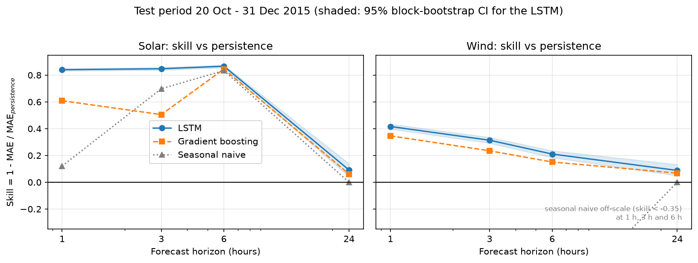
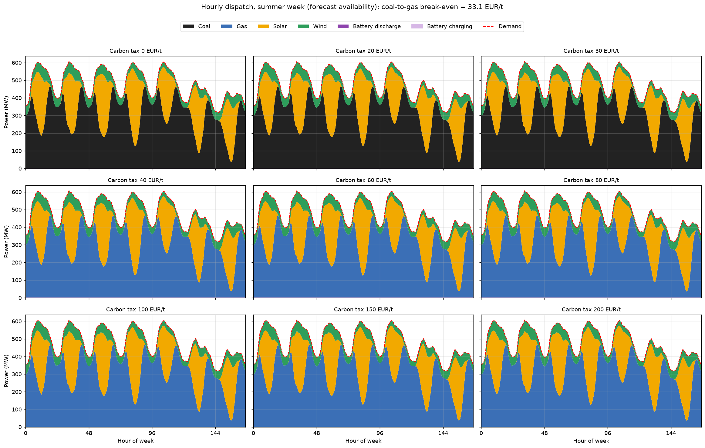
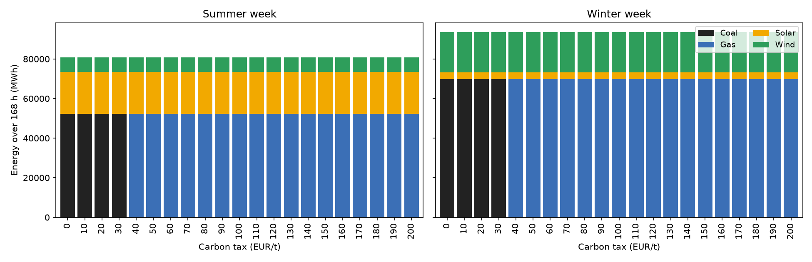

# **Forecast-Driven Energy Dispatch Optimisation: LSTM Renewable Forecasting + PyPSA Carbon-Tax Scenarios**


A two-stage energy-systems pipeline built on **five years (2015 to 2019) of hourly German solar,
wind and load data** from Open Power System Data. Training model uses mini-batches throughout.

1. **Forecasting.** A multi-horizon LSTM predicts solar and wind generation at 1, 3, 6 and 24 hours
   ahead. It is trained on 2015 to 2017, tuned on 2018 and tested on all of 2019, and benchmarked
   against persistence, "same hour yesterday" and gradient boosting, with block-bootstrap
   confidence intervals.
2. **Dispatch optimisation.** The 24 h-ahead forecasts feed a [PyPSA](https://pypsa.org) model of a
   single-bus 110 kV system (coal, gas, solar, wind, battery) driven by real German demand. The model
   finds the cheapest hourly dispatch for 21 carbon taxes (0 to 200 EUR/tCO2), for a winter and a
   summer week of the test year, and reports emissions, cost, prices, curtailment and battery use.

> **Headline results**
> * **Wind forecasting beats persistence significantly.** 1 h MAE 451 vs 773 MW (skill +0.42,
>   95% CI +0.40 to +0.43); skill stays positive at 24 h (+0.09, CI +0.05 to +0.14).
> * **Solar forecasting is very strong at short range:** skill +0.84 to +0.87 at 1 to 6 h; the day-ahead
>   gain is modest (+0.09) because no weather forecasts are used.
> * **The LSTM beats gradient boosting and "same hour yesterday" at every horizon** for both series.
> * **Fuel switching.** Coal and gas break even at **33.1 EUR/tCO2** (analytical). The optimiser reproduces
>   this (coal at 30, gas from 40 EUR/t) and emissions fall by **62%** in both weeks.

---

## **Pipeline**


## **Repository structure**

```
.
├── src/
│   ├── config.py              # every setting in one place (years, splits, costs, seeds)
│   ├── data_utils.py          # loading, cleaning, capacity factors, leakage-safe samples
│   ├── prepare_data.py       # raw OPSD file -> data/generation_data.csv
│   ├── lstm_model.py          # Stage 1: train LSTM ensemble, write forecast.csv
│   ├── evaluate_baselines.py  # benchmark vs persistence / seasonal naive / gradient boosting
│   └── build_network.py       # Stage 2: PyPSA carbon-tax scenarios, sensitivity, figures
├── tests/                     # 22 unit tests (leakage, alignment, cost model, energy balance)
├── notebooks/analysis.ipynb   # results analysis
├── data/                      # time_Series_60min_singleindex.csv (downloaded OPSD file) generation_data.csv (2015-2019, 43,824 rows) + provenance notes
├── output/                    # forecasts, metrics, scenario tables, trained weights, figures
├── .github/workflows/ci.yml   # runs the tests on every push
├── Makefile  requirements.txt  requirements-dev.txt  pytest.ini
└── README.md  CITATION.cff  LICENSE
```

## **Installation**

```bash
git clone https://github.com/Mishal-Asmat/renewable-dispatch-lstm-pypsa.git
cd renewable-dispatch-lstm-pypsa
python -m venv .venv
source .venv/bin/activate          # Windows: .venv\Scripts\activate
pip install -r requirements-dev.txt
```

## **Usage**

All commands run from the repository root. `data/generation_data.csv` is committed.

**Linux / macOS (with `make`)**

```bash
make train      # LSTM ensemble   -> output/forecast.csv, predictions_test.npz, models/
make evaluate   # benchmarks      -> output/forecast_skill.csv, figures/skill_by_horizon.png
make network    # PyPSA scenarios -> output/scenario_results.csv, sensitivity_results.csv, figures/
make notebook   # execute the analysis notebook
make test       # unit tests
```

**Windows (no `make` needed)**

```powershell
python src/lstm_model.py
python src/evaluate_baselines.py
python src/build_network.py
python -m pytest -q
jupyter nbconvert --to notebook --execute --inplace notebooks/analysis.ipynb
```

To build the data file from the downloaded raw OPSD, place `time_series_60min_singleindex.csv` in `data/` and run `python src/dprepare_data.py`.


**Resources (measured, single CPU core, no GPU).** Training 3 seeds x 2 targets takes about 22 minutes
(use `python src/lstm_model.py --quick` for a 1-seed smoke test). Evaluation takes about 15 seconds and the
dispatch stage under 2 minutes. 

---

## **Methods**

### Data and cleaning
Hourly German solar and wind generation, installed capacity and load from Open Power System Data,
**2015 to 2019** (`cfg.MODEL_YEARS`; the loader drops everything else and refuses ranges longer than
`cfg.MAX_YEARS`). True gaps are kept as NaN, interpolates gaps of at most 6 h and excludes any training window that touches a longer gap (103 solar and 74 wind hours were missing in the raw data, all in 2015 and 2016; 79 solar and 54 wind hours remain missing after interpolation and are excluded).

### Capacity factors
Installed capacity grew 31% (solar) and 54% (wind) between end-2015 and end-2019, so raw MW values drift
upward and a model trained on early years would see unfamiliar levels in the test year. All series are
therefore converted to **capacity factors** (generation divided by the real installed capacity from OPSD).

### Splits (chronological, purged)

| Split | Forecast issue times | Samples |
|---|---|---|
| Train | 2015-01-01 to 2017-12-31 | 25,870 |
| Validation (early stopping) | 2018 | 8,736 |
| Test | 2019 (full year, all seasons) | 8,736 |

The last issue time of each split is pulled back by 24 h so no target crosses a split boundary.

### **Stage 1: LSTM**

| Item | Setting |
|---|---|
| Inputs (6) | solar and wind capacity factors, sin/cos of hour of day, sin/cos of day of year |
| Look-back | 48 hours |
| Targets | `y(t+h) - y(t)` for h = 1, 3, 6, 24 h (a **residual** relative to persistence) |
| Models | one LSTM per target (solar, wind); 2 layers, 32 hidden units, dropout 0.2 |
| Training | AdamW (lr 1e-3), L1 loss, gradient clipping, mini-batches of 256, early stopping on validation loss |
| Reproducibility | seeds 0, 1, 2; the reported forecast is the 3-seed ensemble mean |

Predicting the change rather than the level means the network starts at the persistence benchmark and only
has to learn corrections. All data passes through the model in mini-batches (training, validation and
prediction).

### Benchmarks
Persistence `y(t)`; seasonal naive `y(t+h-24)`; gradient boosting (scikit-learn, residual target, lagged
inputs). Metrics are MAE, RMSE and the skill score `1 - MAE_model / MAE_persistence` with a 95% moving-block
bootstrap interval (24 h blocks, 1,000 resamples) that respects the autocorrelation of the errors.

### **Stage 2: PyPSA dispatch**

| Component | Capacity | Marginal cost (EUR/MWh_el) | Notes |
|---|---|---|---|
| Demand | mean 500 MW | n/a | real German load (ENTSO-E via OPSD) rescaled to a 500 MW annual mean |
| Coal | 600 MW | `(10.5 + 0.340 * tax) / 0.35` | 0.971 tCO2 per MWh_el |
| Gas | 1,000 MW | `(27.5 + 0.202 * tax) / 0.55` | 0.367 tCO2 per MWh_el |
| Solar | 800 MW | 0 | availability = LSTM 24 h-ahead capacity factor |
| Wind | 300 MW | 0 | same |
| Battery | 800 MW / 12 h | 10 | 90% charge and discharge efficiency, cyclic state of charge |

Fuel prices are chosen so zero-tax costs equals to the values (gas 50, coal 30 EUR/MWh). Two weeks of the test
year are solved: **winter** (starting 2019-01-14) and **summer** (2019-07-08). Each is solved with the LSTM
forecast and, as a reference, with the actual availability (perfect foresight).

---

## **Results**

### Forecast skill (test year 2019, n = 8,736 hours)

MAE in MW (lower is better):

| Series | Model | 1 h | 3 h | 6 h | 24 h |
|---|---|---|---|---|---|
| Solar | Persistence | 1,295 | 3,772 | 6,839 | 1,140 |
| | Seasonal naive | 1,138 | 1,138 | 1,138 | 1,140 |
| | Gradient boosting | 519 | 1,870 | 1,054 | 1,065 |
| | **LSTM** | **210** | **575** | **918** | **1,039** |
| Wind | Persistence | 773 | 2,076 | 3,507 | 6,836 |
| | Seasonal naive | 6,866 | 6,863 | 6,856 | 6,836 |
| | Gradient boosting | 504 | 1,590 | 2,963 | 6,393 |
| | **LSTM** | **451** | **1,423** | **2,762** | **6,204** |

**LSTM skill vs persistence with 95% block-bootstrap interval:**

| Horizon | Solar | Wind |
|---|---|---|
| 1 h | +0.84 [+0.83, +0.85] | +0.42 [+0.40, +0.43] |
| 3 h | +0.85 [+0.84, +0.86] | +0.32 [+0.29, +0.34] |
| 6 h | +0.87 [+0.86, +0.88] | +0.21 [+0.19, +0.24] |
| 24 h | +0.09 [+0.04, +0.14] | +0.09 [+0.05, +0.14] |



**Reading the table:**

* **The LSTM is the best model in every column**, and every skill interval is above zero.
* **Solar skill at 3 to 6 h is largely the daily cycle** that persistence cannot capture; the fairest solar
  comparison is the seasonal-naive baseline, which the LSTM beats by 82% at 1 h and by 9% at 24 h.
* **The day-ahead (24 h) gain is modest for both series** (about 9% over persistence). Day-ahead skill
  mostly comes from weather forecasts, which this project does not use (see Limitations).

### Carbon-tax scenarios (forecast-driven, 168 h each)

| Week | Tax (EUR/t) | Coal (MWh) | Gas (MWh) | Solar (MWh) | Wind (MWh) | Emissions (tCO2) | Mean price (EUR/MWh) |
|---|---|---|---|---|---|---|---|
| Winter (demand 93,649 MWh) | 0 to 30 | 69,661 | 0 | 3,409 | 20,579 | 67,670 | 30 (at 0), 59 (at 30) |
| Winter | 40 to 200 | 0 | 69,661 | 3,409 | 20,579 | 25,584 | 65 (at 40), 123 (at 200) |
| Summer (demand 80,874 MWh) | 0 to 30 | 52,128 | 0 | 21,281 | 7,465 | 50,639 | 30 (at 0), 59 (at 30) |
| Summer | 40 to 200 | 0 | 52,128 | 21,281 | 7,465 | 19,145 | 65 (at 40), 123 (at 200) |

1. **The switch matches theory.** Coal and gas break even when
   `(50 - 30) / (0.971 - 0.367) = 33.1 EUR/t`, inside the simulated bracket (30, 40] for both weeks.
2. **Renewable output does not depend on the tax**: wind and solar cost nothing, so the tax only reorders
   the thermal merit order. Renewables supply about 26% (winter) and 36% (summer) of demand.
3. **Emissions fall by 62.2%** at the switch in both weeks, and the electricity price follows the marginal fuel.
4. **Seasonal complementarity is visible**: wind dominates the winter week, solar the summer week.
5. **Forecast error matters for planning.** Planned emissions differ from the perfect-foresight run by +3.1%
   in winter (solar availability under-forecast by 20%) and -7.4% in summer (solar over-forecast by 20%,
   wind by 10%). These are planned, not realised, outcomes (see Limitations).




### High-renewables sensitivity (when does the battery matter?)

At the base capacities (800 MW solar, 300 MW wind) renewables never exceed demand and thermal cost is flat, so the battery is idle. Scaling
the renewable fleet (tax 0):

| Week | Capacity scale | Coal (MWh) | Curtailed (MWh) | Battery discharge (MWh) | Emissions (tCO2) |
|---|---|---|---|---|---|
| Winter | 1x | 69,661 | 0 | 0 | 67,670 |
| Winter | 3x | 22,034 | 0 | 1,490 | 21,404 |
| Winter | 6x | 0 | 49,334 | 4,034 | 0 |
| Summer | 1x | 52,128 | 0 | 0 | 50,639 |
| Summer | 3x | 367 | 14 | 24,365 | 356 |
| Summer | 6x | 0 | 88,838 | 11,774 | 0 |

In summer the battery is heavily used already at 3x (solar surplus shifted to the evening); at 6x the fleet
overshoots demand and curtailment dominates, which is where storage sizing becomes the key design question.

---

## Limitations

These define the scope of the claims above.

1. **No weather inputs.** Only past generation and calendar features are used. Numerical weather forecasts
   are the main driver of day-ahead skill, which is why the 24 h gain is modest.
2. **Planned, not realised, cost.** The forecast-driven and perfect-foresight runs are separate optimisations.
   A two-stage model (day-ahead plan plus real-time re-dispatch) would give realised cost and the true value of forecast accuracy.
3. **Stylised power system.** Single bus, hypothetical capacities, illustrative fuel prices. The 33.1 EUR/t break-even depends on those inputs. National German capacity factors
   are applied to an 800 / 300 MW fleet.
4. **Two dispatch weeks.** One winter and one summer week illustrate the results; they are not a full-year
   system simulation.
5. **Capacity factors can slightly exceed 1.** The OPSD capacity series is stepwise, so generation is
   occasionally a few percent above the listed capacity; availability is clipped to [0, 1] in the dispatch model.
6. **Data gaps.** 79 solar and 54 wind hours (2015 and 2016) remain missing after interpolation; windows
   touching them are dropped, not imputed.
7. **Limited tuning and one test year.** Hyperparameters were set once and not tuned; results are for 2019 only.
   Intervals reflect sampling variation within that year, not year-to-year variation.

## Roadmap

- [ ] Add wind-speed and irradiance inputs (OPSD weather data or ERA5) and test their effect on 24 h skill
- [ ] Two-stage day-ahead / real-time dispatch to quantify the value of forecast accuracy
- [ ] Rolling-origin evaluation over several test years
- [ ] Hyperparameter search and probabilistic (quantile) forecasts
- [ ] Full-year dispatch instead of two representative weeks

## Data and attribution

Generation, capacity and load data: Open Power System Data, *Data Package Time series*
(https://data.open-power-system-data.org/time_series/), licensed CC BY 4.0. See `data/README.md`.

**Optimisation framework:** T. Brown, J. Hörsch, D. Schlachtberger, *PyPSA: Python for Power System
Analysis*, Journal of Open Research Software 6(1), 2018.

## **Citation**

See `CITATION.cff`, or:

```bibtex
@software{asmat_2026_lstm_pypsa,
  author  = {Mishal Asmat},
  title   = {Forecast-Driven Energy Dispatch Optimisation: LSTM Renewable Forecasting
             and PyPSA Carbon-Tax Scenarios},
  year    = {2026},
  url     = {https://github.com/Mishal-Asmat/renewable-dispatch-lstm-pypsa}
}
```

## **License**

MIT, see [LICENSE](LICENSE).
